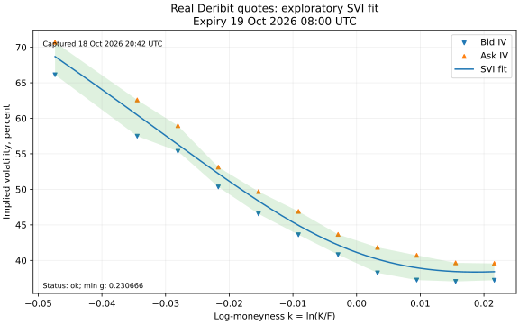

# Are BTC option probabilities calibrated?

[](https://github.com/50kfunded/implied-odds/actions/workflows/tests.yml)

I'm testing whether BTC option-implied risk-neutral probabilities match realised settlement frequencies.
I fit checked SVI smiles to Deribit quotes and freeze their CDFs before expiry.
I compare the frozen distributions with official delivery prices and three baselines using proper scores and dependence-aware uncertainty.

## Status

8 of 8 implementation phases complete. Prospective research is in progress.
I've captured real option quotes and hourly history and fitted real market smiles.
I haven't collected settled research forecasts, so calibration is still unmeasured.
My fixed protocol requires effective N >= 60 before I draw a headline conclusion.

## Results so far

I captured this production snapshot on 18 October 2026 at 20:42 UTC.
These are real quote-fit diagnostics. I keep the [inputs and hashes](recordings/live-02/manifest.json)
and rebuild every slice, including failed fits, with `scripts/reproduce.py`.

| Check | Real market result |
| --- | ---: |
| Quotes / expiry slices | 928 / 12 |
| Usable OTM quotes | 383 |
| Accepted SVI CDFs after all checks | 4 / 12 |
| Butterfly / calendar rejections | 3 / 5 |
| Completed hourly closes available before the snapshot | 2,162 |
| Settled frozen research forecasts / effective N | 0 / 0 |
| Calibration / primary CRPS comparison | Insufficient data |



I show the earliest accepted expiry in that snapshot, 19 October at 08:00 UTC.
The fit has 11 strikes, 0.346 vol-point RMSE and 7.01% extrapolated probability mass.
This exploratory fit isn't a frozen research forecast. My [research note](report/research-note.md)
explains the gate correction, selection rule, rejected slices and remaining limits.

## Run it

I use Python 3.11 or later. From this repo, I rebuild offline on Windows:

```powershell
python -m venv .venv
.\.venv\Scripts\python.exe -m pip install -e .
.\.venv\Scripts\python.exe -m unittest discover -s tests -v
.\.venv\Scripts\python.exe scripts/reproduce.py
```

On macOS or Linux:

```sh
python3 -m venv .venv
.venv/bin/python -m pip install -e .
.venv/bin/python -m unittest discover -s tests -v
.venv/bin/python scripts/reproduce.py
```

I open `results/reproduction/index.html` for the real snapshot, frozen-score report
and separate synthetic illustration. I start and stop the local collector with the
[live commands](report/research-note.md#running-the-pipeline). It captures options every
five minutes, refreshes hourly history, freezes due forecasts and scores deliveries.
I keep the PC awake and online; downtime stays visible in its heartbeat and status.

## Method and data

I keep missing quote sides as nulls, convert BTC premiums with the expiry's forward,
then check IV conventions, butterflies and calendars before extracting a risk-neutral CDF.
My primary comparison is 24-hour USD CRPS against the same-snapshot ATM lognormal.
The realised-vol and GARCH baselines need history fetched before the option snapshot.
Raw gzip JSON-lines retain response bodies and request timings; SQLite holds immutable forecasts.

## Limits

Risk-neutral probabilities include risk premia, so they can differ from realised frequencies.
I use one venue and a short sample; overlapping outcomes reduce effective sample size.
Settlement is a 30-minute index TWAP. Thin wings need extrapolation, and calendar checks
can reject slices because of extrapolated wings. Quotes and the index aren't atomic.
Crypto funding, jumps and market structure affect comparisons. GARCH uses a finite simulation.
The minimum eligible expiry doesn't guarantee that every lead is listed in time.

## Files

- `src/implied_calibration/`: my collector, pricing, forecasts, inference and reports.
- `tests/` and `.github/workflows/tests.yml`: my offline checks on Windows and Linux.
- `scripts/reproduce.py` and `recordings/`: my offline rebuild and small retained samples.
- `protocol/`: my fixed choices and committed locks.
- `report/research-note.md`: my method, input format, evidence and research limits.

## Next

I'll collect qualifying snapshots, score settled forecasts and study calibration once enough outcomes exist.
I haven't picked a licence yet.
