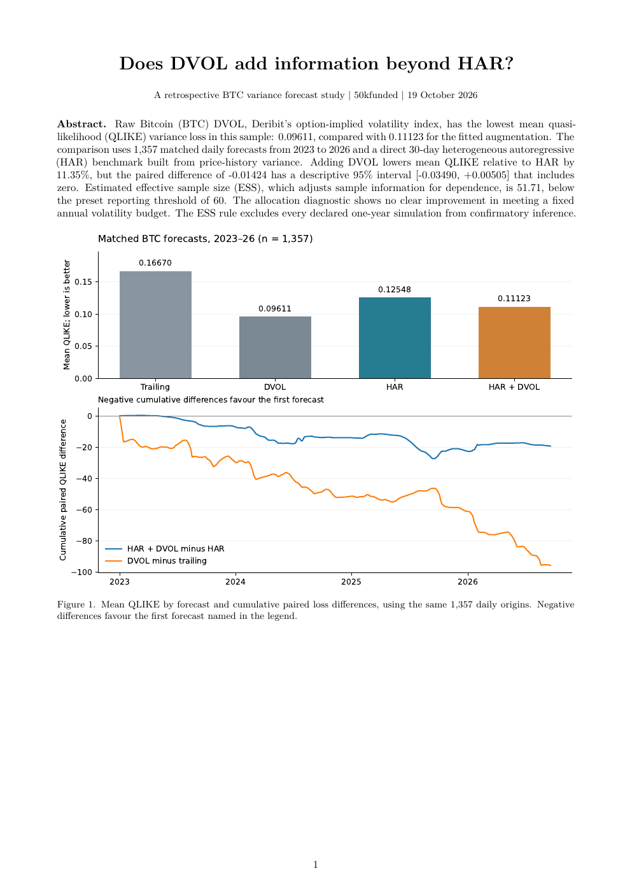

# Does DVOL add information beyond HAR?

[Research paper](report/latex/main.pdf) · [LaTeX source](report/latex/main.tex) · [Results and diagnostics](report/incremental-results.json) · [](https://github.com/50kfunded/implied-odds/actions/workflows/tests.yml)

I'm testing whether BTC DVOL, Deribit's option-implied volatility index for bitcoin, adds information beyond a heterogeneous autoregressive (HAR) model built from daily, weekly and monthly price-history variance.
Raw DVOL has the lowest mean quasi-likelihood (QLIKE) loss in this sample, but its paired difference from HAR + DVOL is -0.01513 with a descriptive 95% interval [-0.03939, +0.00817] that includes zero.
Across 1,357 matched 30-day forecasts, HAR + DVOL also lowers mean QLIKE loss relative to HAR, while the uncertainty interval spans zero and the variance-budget diagnostic shows no clear gain.

| Forecast | Mean QLIKE loss, lower is better |
| --- | ---: |
| trailing variance | 0.16670 |
| Raw DVOL | 0.09611 |
| HAR | 0.12548 |
| HAR + DVOL | 0.11123 |

HAR + DVOL minus HAR has mean QLIKE difference -0.01424 and a descriptive 95% interval [-0.03490, +0.00505]. Its estimated effective sample size (ESS), a dependence-adjusted measure of information, is 51.71; the raw-DVOL comparison has ESS 53.44. Both fall below the preset reporting rule of 60, which is a design choice rather than a validated significance cutoff. Neither regression reaches its fixed positivity floor.

[](report/latex/main.pdf)

## Limits and status

The historical findings are exploratory. The original open, high, low and close (OHLC) input check fails on an unused DVOL open; the three audited closes match. Chronological fitting and mean QLIKE rankings alone establish neither statistical superiority nor a trading result. The paper's [limitations section](report/latex/main.pdf) explains the data, dependence and variance-budget assumptions.

A locked year starts on 21 October 2026. Every declared one-year synthetic replication fails the ESS reporting rule, so the inference amendment makes this an evidence-collection period. A separate stochastic volatility inspired (SVI) option-probability study has zero settled forecasts.

## Run it

With Python 3.12 on Windows, the numerical results rebuild offline:

```powershell
python -m venv .venv
.\.venv\Scripts\python.exe -m pip install -r requirements-research.txt -e ".[research,dev]"
.\.venv\Scripts\python.exe -m unittest discover -s tests
.\.venv\Scripts\python.exe scripts/build_research.py
```

On macOS or Linux, I replace `.\.venv\Scripts\python.exe` with `.venv/bin/python`. The outputs are `results/research/summary.json` and `forecasts.csv`.

The paper compiles separately with [these LaTeX commands](report/latex/README.md). Its printed values live in `main.tex` and are checked against the rebuilt results before manuscript revisions.

## Collection and provenance

Forecasts retain immutable raw capture segments with code and input hashes. Recoverable delivery-pagination failures retry in fresh segments; conflicting immutable prices stop collection. Cleaning is cached by input, protocol, code and runtime fingerprints, and reports render outside the forecast loop. The [scoreboard snapshots](report/scoreboard.html) publish counts, rejection reasons, local hashes and heartbeat age.

Local hash chains have no independent public timestamp. A fresh heartbeat records activity but doesn't establish that collection is healthy. The short supervised recordings demonstrate bounded validation; continuous collection needs an awake, online host. The numerical rebuild retains the full report and matched forecast records, alongside coefficients, training cutoffs, diagnostics, simulation rates and plan hashes.

[Methods and live commands](report/research-note.md) · [Locked plan](protocol/incremental-variance-v1.json) · [Inference amendment](protocol/inference-validation-v1.json) · [Retained public inputs](recordings/historical-variance/manifest.json). Source is in `src/implied_calibration/`; checks are in `tests/`.

The code has an [MIT licence](LICENSE). Retained Deribit responses keep their original source provenance.
