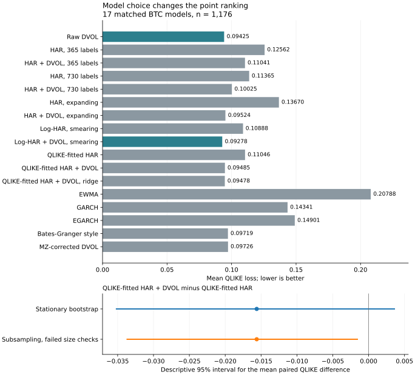

# Does DVOL add information beyond HAR?

Does option-implied variance improve Bitcoin's 30-day forecasts beyond a heterogeneous autoregressive model? I'm testing that question with retained Deribit data. A declared 17-model comparison changes the point ranking: log-HAR + DVOL scores best, while the focal paired bootstrap interval still includes zero.

DVOL is Deribit's option-implied volatility index; HAR is a heterogeneous autoregressive model of realised variance.

<a href="report/latex/main.pdf"></a>

```sh
python scripts/build_research.py
python scripts/build_review.py
```

[](https://github.com/50kfunded/implied-odds/actions/workflows/tests.yml) · [Paper](report/latex/main.pdf) · [V2 results](report/v2-results.md) · [Original results](report/incremental-results.json) · [LaTeX](report/latex/main.tex) · [Latest release](https://github.com/50kfunded/implied-odds/releases/latest) · [All versions DOI](https://doi.org/10.5281/zenodo.23606990)

The original 1,357-origin results are preserved. V2 matches 17 specifications on a later 1,176-origin cohort: log-HAR + DVOL has mean QLIKE 0.09278, raw DVOL 0.09425, QLIKE-fitted HAR + DVOL 0.09485 and QLIKE-fitted HAR 0.11046. The focal fitted difference is -0.01561 with descriptive 95% interval [-0.03517, +0.00359] and effective sample size 56.85. These additions were publicly declared before evaluation, after inspection of v1. They remain exploratory.

The new subsampling candidate fails the synthetic size checks, so I don't replace the bootstrap with it. An original vendor OHLC check fails on an unused DVOL open; the audited closes match. The prospective year remains best-effort evidence collection. The publication workflow is disabled pending a hosted-runner probe and activation; I haven't established continuous operation.

## Set up

I use Python 3.12.10 and the pinned research environment:

```sh
python -m venv .venv
python -m pip install -r requirements-research.txt -e ".[research,dev]"
python -m unittest discover -s tests
```

I activate `.venv` before the install and run commands. On Windows PowerShell that's `.\.venv\Scripts\Activate.ps1`; on macOS or Linux it's `source .venv/bin/activate`. The rebuild uses retained public inputs offline and writes `summary.json`, `forecasts.csv` and `extensions-forecasts.csv` under `results/research/`.

[Methods, collection and provenance](report/research-note.md) · [Declared additions](protocol/exploratory-dvol-v1.json) · [Locked prospective plan](protocol/incremental-variance-v1.json) · [Compile the paper](report/latex/README.md)

The original study is in `incremental.py`, `exploratory_extensions.py` and `incremental_report.py` under `src/implied_calibration/`. V2 is in `review_models.py`, `inference_reference.py` and `review_report.py`; tests are in `tests/`. The [claim map](report/claim-map.md) connects the findings to code and tests. The separate unfinished [SVI study](studies/svi/README.md) has its own marked documentation folder and shares library code.

Next I'd declare a prospective comparison of matched positive-variance models, validate public collection, and audit ETH before adding a second asset. The [prospective v2 draft](protocol/prospective-v2-draft.json) is inactive and doesn't replace the original locks.

The code has an [MIT licence](LICENSE). Retained Deribit responses keep their source provenance. [Citation metadata](CITATION.cff).
