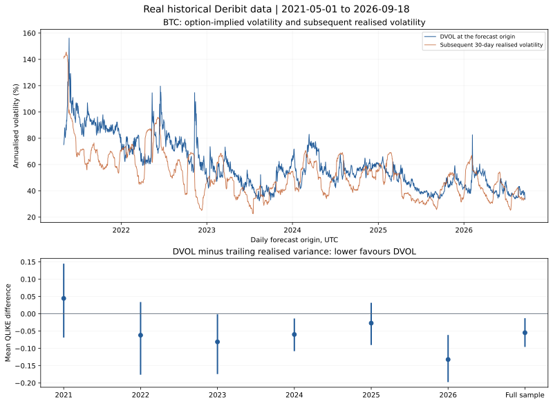

# Do BTC option prices forecast future volatility?

[](https://github.com/50kfunded/implied-odds/actions/workflows/tests.yml)

I'm testing whether BTC option prices help forecast future volatility.
I compared 1,967 historical forecasts and found 29.2% lower mean QLIKE loss for DVOL than trailing realised variance, with almost no extra gain from a past-only correction.
I also build and freeze SVI probability distributions for a separate prospective calibration study.

## Status

8 of 8 implementation phases complete. Historical results are reproducible offline.
One vendor OHLC check failed, so I keep the historical comparison descriptive.
The fixed non-overlapping sample's interval includes zero.
I haven't collected settled SVI forecasts yet, so full probability calibration is unmeasured.

## Historical results

I use daily origins from 1 May 2021 through 18 September 2026 and subsequent 30-day
BTC-PERPETUAL returns. I retained 48,626 hourly price candles and 1,996 daily DVOL
candles, with no excluded origins. Lower QLIKE means lower variance forecast loss.

| Measure | Real historical result |
| --- | ---: |
| Paired daily origins / effective N | 1,967 / 126.8 |
| Mean QLIKE: DVOL / trailing 30-day variance | 0.13236 / 0.18699 |
| Paired loss difference, DVOL minus trailing | -0.05463 |
| Descriptive 95% interval, 60-day expected blocks | -0.09374 to -0.01459 |
| Mean implied minus subsequent realised volatility | +7.55 volatility points |
| Origins with lower DVOL loss | 968 / 1,967, or 49.2% |
| Fixed non-overlapping sample | 66 targets, interval -0.09374 to +0.01071 |
| Correction / raw DVOL loss on the same 1,357 origins | 0.09582 / 0.09611 |
| Daily/hourly OHLC checks | 8 / 9 pass; one DVOL open differs |



DVOL does worse in 2021. Its lower average loss doesn't mean it wins on most days.
I publish the [unchanged inputs](recordings/historical-variance/manifest.json),
[refetch audit](recordings/historical-alignment-audit/manifest.json) and
[annual results, timing rules and limits](report/research-note.md#historical-variance-study).
These are historical variance results, not trading returns or a full-CDF calibration result.

## Run it

I use Python 3.11 or later. From this repo, I rebuild offline on Windows:

```powershell
python -m venv .venv
.\.venv\Scripts\python.exe -m pip install -e .
.\.venv\Scripts\python.exe -m unittest discover -s tests -v
.\.venv\Scripts\python.exe scripts/reproduce.py
```

On macOS or Linux:

```sh
python3 -m venv .venv
.venv/bin/python -m pip install -e .
.venv/bin/python -m unittest discover -s tests -v
.venv/bin/python scripts/reproduce.py
```

I open `results/reproduction/index.html` for the historical study, real smile fit,
frozen-score report and separate synthetic illustration. The historical report
includes individual outcomes in CSV and all diagnostics in JSON. CI rebuilds the reports.
I leave the local collector stopped; the [live commands](report/research-note.md#running-the-pipeline)
start a separate job when I'm ready to collect prospective forecasts.

## Method and data

I compare the previous completed DVOL close squared with trailing 720-hour realised
variance, then score both against the next 720 hourly returns. My correction uses
only the latest 365 completed outcomes. I use paired stationary-bootstrap intervals,
59-day HAC lags and an effective N minimum of 60. Historical downloads aren't original data vintages.
Raw gzip JSON-lines retain response bodies and request timings; manifests retain hashes.

My SVI study checks option prices, butterflies and calendars before extracting a CDF.
Its fixed primary comparison remains 24-hour USD CRPS against the ATM lognormal.
The original protocol and baseline locks stay unchanged. Its [real snapshot](report/market-smile.svg)
and [method](report/research-note.md) remain available.

## Files

- `src/implied_calibration/`: my collection, pricing, forecasts, inference and reports.
- `tests/` and `.github/workflows/tests.yml`: my offline checks and Windows/Linux CI.
- `scripts/reproduce.py` and `recordings/`: my offline rebuild and retained public inputs.
- `protocol/`: my fixed prospective locks and separate historical study choices.
- `report/research-note.md`: my results, methods, input format and research limits.

## Next

I'll resolve the vendor OHLC discrepancy and test the variance result on a new period.
I'll collect prospective SVI forecasts before claiming anything about probability calibration.

I haven't picked a licence yet.
