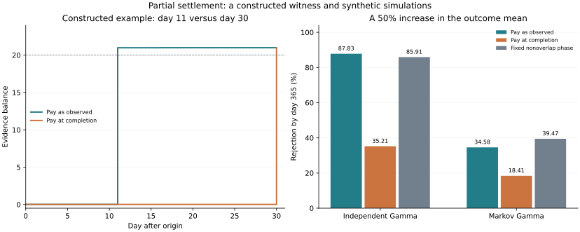

# Can overlapping risk forecasts be monitored before their outcomes finish?

I'm studying 30-day BTC and ETH variance forecasts and how to monitor them as squared returns accumulate. The new method reserves evidence capital at each origin and credits only verified nonnegative outcomes; its false-alarm bound needs an origin-conditional mean restriction. In a constructed example it crosses the evidence threshold on day 11 instead of day 30, and fixed-policy simulations show both its gains and a setting where a nonoverlapping comparator has higher power.

<a href="report/progressive-evidence.md"></a>

```sh
python scripts/build_followup.py --check
```

[](https://github.com/50kfunded/implied-odds/actions/workflows/tests.yml) · [Method, proof and results](report/progressive-evidence.md) · [BTC/ETH QLIKE attribution](report/qlike-attribution.md) · [ETH study](report/eth-relative-results.md) · [Sampling check](report/frequency-results.md)

## Where it's at

The monitoring method is a research prototype with a written proof, six exhaustive finite-tree checks and 10,000-path simulations. Worldwide priority hasn't been established, and no live monitoring test is active. Its conditional null differs from average forecast superiority and doesn't repair the historical bootstrap calibration failures.

The matched BTC/ETH study covers 1,184 origins. Adding DVOL to separate log-HAR models lowers pooled QLIKE by 6.17%, but raises it by 1.56% from January 2024 onward. These historical comparisons and time slices remain exploratory; the [exact attribution](report/qlike-attribution.md) shows how common-level and relative errors change across years.

DVOL is Deribit's option-implied volatility index. HAR is a heterogeneous autoregressive model of realised variance. QLIKE measures variance forecast error; lower is better. The BTC/ETH comparison uses retained hourly perpetual prices and daily DVOL; the frequency audit also retains five-minute prices.

## Set up

I use Python 3.12.10 and the pinned research environment:

```sh
python -m venv .venv
python -m pip install -r requirements-research.txt -e ".[research,dev]"
python -m unittest discover -s tests
```

I activate `.venv` before the install and run commands. On Windows PowerShell that's `.\.venv\Scripts\Activate.ps1`; on macOS or Linux it's `source .venv/bin/activate`. I clone with Git history because the earlier studies check their declaration commits. The follow-up rebuild uses retained public inputs offline and writes summaries, forecasts and figures under `results/followup/`; `--check` compares the reported numbers and generated passages.

For the earlier BTC studies:

```sh
python scripts/build_research.py
python scripts/build_review.py
```

The [BTC paper](report/latex/main.pdf), [LaTeX](report/latex/main.tex), [v2 results](report/v2-results.md) and [released BTC DOI](https://doi.org/10.5281/zenodo.23606990) describe the earlier BTC study. The new method and ETH follow-up aren't in that released paper. [Methods and provenance](report/research-note.md) · [Compile the BTC paper](report/latex/README.md).

## Repo map and next step

`progressive_evidence.py` holds the ledger and directional QLIKE bound; `progressive_report.py` holds exact checks and fixed-policy simulations. `qlike_attribution.py` and `frequency_audit.py` rebuild the historical follow-up. The matched BTC/ETH models are in `relative_variance.py`; the earlier BTC models are in `incremental.py` and `review_models.py`, all under `src/implied_calibration/`. The [claim map](report/claim-map.md) connects results to tests. The unfinished [SVI study](studies/svi/README.md) shares legacy library code.

Next I'd seek an external review of the monitoring proof and fix a new future data protocol before using it live. The [original prospective locks](protocol/incremental-variance-v1.json) remain intact; the [v2 draft](protocol/prospective-v2-draft.json) stays inactive.

The code has an [MIT licence](LICENSE). Retained Deribit responses keep their source provenance. [Citation metadata](CITATION.cff).
