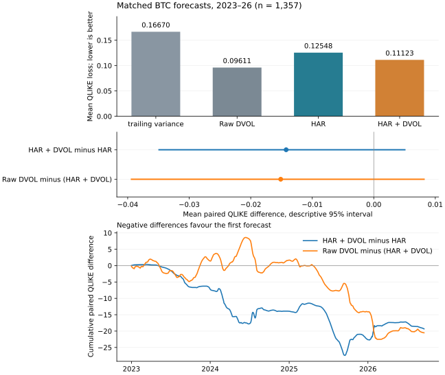

# Does DVOL add information beyond HAR?

I'm testing 30-day BTC variance forecasts: raw DVOL's lead over HAR + DVOL is concentrated in 2025–26, rolling rescaling changes little, and the paired intervals leave the ranking uncertain.

DVOL is Deribit's option-implied volatility index; HAR is a heterogeneous autoregressive model of realised variance.

<a href="report/latex/main.pdf"></a>

```sh
python scripts/build_research.py
```

[](https://github.com/50kfunded/implied-odds/actions/workflows/tests.yml) · [Paper](report/latex/main.pdf) · [Results](report/incremental-results.json) · [LaTeX](report/latex/main.tex) · [v1.0 and DOI](https://doi.org/10.5281/zenodo.23606991)

Across 1,357 matched daily origins, mean QLIKE loss is 0.09611 for raw DVOL, 0.09582 for rolling-rescaled DVOL, 0.09937 for a fixed 50/50 HAR–DVOL variance blend, 0.11123 for HAR + DVOL and 0.12548 for HAR. Lower is better. The paper reports paired intervals, effective sample sizes and annual results. The fixed-weight and scaling additions are exploratory and leave the locked prospective contrast unchanged.

Historical findings remain exploratory. An original vendor OHLC check fails on an unused DVOL open; the audited closes match. The prospective year is evidence collection, and bounded local validation doesn't establish continuous operation. The paper explains the remaining data and inference limits.

## Set up

I use Python 3.12.10 and the pinned research environment:

```sh
python -m venv .venv
python -m pip install -r requirements-research.txt -e ".[research,dev]"
python -m unittest discover -s tests
```

I activate `.venv` before the install and run commands. On Windows PowerShell that's `.\.venv\Scripts\Activate.ps1`; on macOS or Linux it's `source .venv/bin/activate`. The rebuild uses retained public inputs offline and writes `summary.json`, `forecasts.csv` and `extensions-forecasts.csv` under `results/research/`.

[Methods, collection and provenance](report/research-note.md) · [Declared additions](protocol/exploratory-dvol-v1.json) · [Locked prospective plan](protocol/incremental-variance-v1.json) · [Compile the paper](report/latex/README.md)

The DVOL study is in `src/implied_calibration/incremental.py`, `exploratory_extensions.py` and `incremental_report.py`; tests are in `tests/`. The separate unfinished [SVI study](studies/svi/README.md) has its own marked documentation folder and shares library code.

Next I'd test a declared log-variance HAR specification or an independently audited ETH sample. Neither is part of these results.

The code has an [MIT licence](LICENSE). Retained Deribit responses keep their source provenance. [Citation metadata](CITATION.cff).
