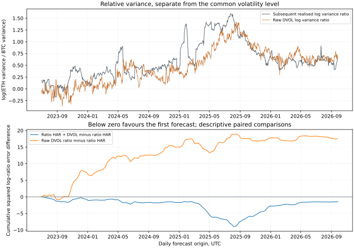

# Does DVOL predict ETH risk relative to BTC?

Adding DVOL to separate log-HAR models changes mean QLIKE by -15.32% for BTC and +2.86% for ETH. Raw DVOL's direct ETH/BTC log-ratio error is +22.79% relative to ratio-HAR's. That paired relative-risk difference is +0.01482, descriptive 95% interval [+0.00220, +0.02913], with effective sample size (ESS) 60.99. The individual-asset and relative-risk targets give different forecast rankings in this sample.

I compare 1,184 matched daily origins from 2023-07-01 to 2026-09-26. The target is the log ratio of subsequent 30-day ETH variance to BTC variance, measured from hourly perpetual returns. This asks whether options distinguish relative risk, after removing a common multiplicative variance level.

Adding the DVOL log ratio to a direct ratio-HAR model changes mean squared log-ratio error by -0.00126, a 1.94% point reduction, with descriptive 95% interval [-0.01223, +0.00851] and effective sample size 26.33. This is the primary comparison. The primary interval includes zero.

## Matched relative-risk forecasts

Ratio HAR fits the next 30-day log variance ratio to the trailing 1-, 7- and 30-day log realised-variance ratios. Ratio HAR + DVOL adds the current log ratio of DVOL variances. Both regressions use the same 730 completed labels and OLS, which matches the squared-error objective. Calibrated DVOL adds the mean completed log error from those labels. The completed-label mean uses their average target; the raw DVOL and trailing ratios have no fitted coefficients.

| Forecast | Mean squared log-ratio error |
| --- | ---: |
| Completed-label mean | 0.17809 |
| Trailing ratio | 0.05790 |
| Raw DVOL ratio | 0.07982 |
| Calibrated DVOL ratio | 0.07157 |
| Ratio HAR | 0.06500 |
| Ratio HAR + DVOL | 0.06374 |

| Paired comparison | Mean difference | Descriptive 95% interval | ESS |
| --- | ---: | --- | ---: |
| Ratio HAR + DVOL minus Ratio HAR | -0.00126 | [-0.01223, +0.00851] | 26.33 |
| Raw DVOL ratio minus Ratio HAR | +0.01482 | [+0.00220, +0.02913] | 60.99 |
| Raw DVOL ratio minus Completed-label mean | -0.09827 | [-0.23683, -0.00296] | 8.07 |
| Calibrated DVOL ratio minus Raw DVOL ratio | -0.00824 | [-0.03981, +0.02264] | 11.15 |



## Marginal forecasts use the same origins

| Asset | Raw DVOL QLIKE | Log-HAR QLIKE | Log-HAR + DVOL QLIKE | Added DVOL difference and interval |
| --- | ---: | ---: | ---: | --- |
| BTC | 0.09381 | 0.10906 | 0.09235 | -0.01671 [-0.03756, +0.00361] |
| ETH | 0.09074 | 0.11048 | 0.11364 | +0.00316 [-0.02183, +0.03109] |

ETH minus BTC's incremental QLIKE difference is +0.01986, interval [-0.00230, +0.04478]. Both assets share bootstrap dates; their difference uses paired dates rather than two independent samples.

## Common and relative log errors

For each marginal forecast, I split log errors into their average across assets and their ETH-minus-BTC difference. A common multiplicative forecast error cancels from the difference. These diagnostics use squared log errors, which differ from QLIKE.

| Marginal forecast | Shared-component mean squared error | Relative-component mean squared error | Log-error correlation |
| --- | ---: | ---: | ---: |
| Raw DVOL | 0.17544 | 0.07982 | 0.813 |
| Log-HAR | 0.23141 | 0.06875 | 0.850 |
| Log-HAR + DVOL | 0.18779 | 0.08909 | 0.791 |

Log-HAR + DVOL minus log-HAR changes the shared component by -0.04363, interval [-0.09479, -0.00112].

Log-HAR + DVOL minus log-HAR changes the relative component by +0.02034, interval [-0.02073, +0.06917].

The shared component changes by -18.85% and the relative component by +29.59%. These averages distinguish the shared volatility-level error from the error in relative risk sizing.

This is an error decomposition, not an identified causal market factor. The ratio of two conditional variance means can differ from the conditional mean log ratio.

## Time and alignment checks

| Year | Origins | Ratio HAR + DVOL minus ratio HAR | Raw DVOL ratio minus ratio HAR |
| --- | ---: | ---: | ---: |
| 2023 | 184 | -0.00529 | +0.03766 |
| 2024 | 366 | -0.00202 | +0.02199 |
| 2025 | 365 | -0.00286 | +0.00758 |
| 2026 | 269 | +0.00470 | -0.00075 |

| Fixed sample half | Origins | Ratio HAR + DVOL minus ratio HAR | Raw DVOL ratio minus ratio HAR |
| --- | ---: | ---: | ---: |
| first | 592 | -0.00249 | +0.02945 |
| second | 592 | -0.00003 | +0.00018 |

| Check | Origins | Ratio HAR + DVOL minus ratio HAR | Descriptive 95% interval |
| --- | ---: | ---: | --- |
| Main | 1184 | -0.00126 | [-0.01223, +0.00851] |
| one_day_DVOL_lag | 1184 | -0.00102 | [-0.01163, +0.00858] |
| one_hour_target_shift | 1184 | -0.00118 | [-0.01218, +0.00866] |

The JSON also retains both fixed sample halves, all 30 dependent nonoverlap phases, the largest absolute loss contributions and 30-, 90- and 180-day bootstrap blocks.

## Why this matters and what it leaves open

For a forecast log ratio z, the standalone variance-budget weights are `w_ETH = 1/(1+exp(z/2))` and `w_BTC = 1-w_ETH`. Their squared log realised variance-contribution imbalance equals the forecast loss in the first table. This gives the error a risk-sizing interpretation; it excludes covariance contributions and trading performance.

**Research choices.** I fixed the local specification after seeing BTC results and the literature, before collecting or scoring ETH. It has no independent pre-evaluation timestamp. Every result is exploratory. This extension preserves the BTC paper and prospective locks.

**Inference.** The intervals use 5,000 stationary bootstrap resamples with a mean block length of 60 days and shared dates across assets. The earlier bootstrap size failures still apply; clearing the ESS reporting rule alone cannot justify a formal claim. ESS is the smaller estimate from the initial positive monotone autocorrelation pairs and a 59-lag Newey-West long-run variance, capped at the origin count. The inherited threshold of 60 is a reporting convention, not a guarantee of calibrated test size.

**Data.** Two correlated crypto assets add less evidence than two independent markets. Hourly perpetual variance is a proxy for option-index risk. Taking logs can change measurement bias even when each variance proxy is unbiased. A synthetic test demonstrates this gap; the empirical target remains the observed hourly-variance ratio, rather than an unobserved true variance ratio.

## Data and reproduction

I retain 97,682 hourly candles across the two assets. Independent target reconstruction checks 2,368 asset targets; the maximum relative difference is 4.66e-16.

```sh
python scripts/build_relative.py
```

[Fixed specifications](../protocol/eth-relative-variance-v1.json) · [Full computed results](eth-relative-results.json)

I refresh BTC and ETH in separate hashed recording folders. `source_audits`, `btc_vintage_audit` and `btc_vintage_scores` report gaps, close alignment, unused OHLC discrepancies and revisions relative to the old BTC inputs. Across 48,626 overlapping BTC price candles and 1,996 DVOL candles, 0 closes changed. The three reused BTC model means also match the original v2 cohort.

## Research context

ETH volatility forecasting with HAR and cross-market inputs already appears in [Chen (2024)](https://doi.org/10.1080/23322039.2023.2300925). [Chevallier and Sanhaji (2023)](https://doi.org/10.3390/stats6040082) study implied-volatility inputs for BTC and ETH forecasts. [Amberdata (2023)](https://blog.amberdata.io/fresh-new-features-relative-volatility-charts) already charts relative implied volatility. The distinct question here is a matched direct forecast of the realised ETH/BTC variance ratio. I make no claim to the first relative-volatility study. [Patton (2011)](https://doi.org/10.1016/j.jeconom.2010.03.034) explains why proxy noise and the choice of loss matter for variance forecast rankings. Its conditions for QLIKE do not automatically carry over to squared log-ratio error.

DVOL construction and data fields follow [Deribit’s methodology](https://insights.deribit.com/exchange-updates/dvol-deribit-implied-volatility-index/) and [API documentation](https://docs.deribit.com/api-reference/market-data/public-get_volatility_index_data), accessed 27 October 2026.
