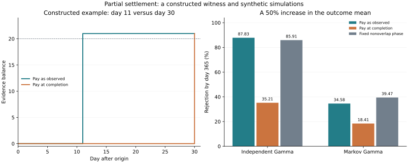

# Anytime monitoring of overlapping forecasts from partially revealed outcomes

I'm proposing a cash-reserved evidence process for nonnegative additive outcomes. My motivation is the 30-day variance forecasts in implied-odds: windows overlap, targets take a month to finish, and the existing bootstrap experiments don't give reliable nominal test size.

This is a proposed method under a different, stronger hypothesis. It doesn't establish a new market anomaly or repair the old bootstrap intervals. Worldwide priority hasn't been established. I compare its information requirements with four closely related primary sources below.

## The question

Can I monitor a rolling 30-day forecast using the variance already accumulated, with finite-sample false-alarm control, when I only have an upper bound on the full-window conditional mean?

I don't assume a distribution for daily returns, an outcome ceiling, independence, a bound on each day's conditional mean, or the ability to update the forecaster's distribution for outstanding targets. The null does require a conditional upper-mean bound at every origin where I buy a claim.

## Setting and algorithm

Let F_t contain everything observed by time t. Claim i is issued at time a_i and has nonnegative dividends d_i,u, paid after issuance. Its total payoff is Z_i = sum_u d_i,u. Under every null law P,

$$\mathbb E_P[Z_i\mid\mathcal F_{a_i}]\leq 1.$$

Claims may overlap. At issuance I choose a stake s_i using the information available then, with 0 <= s_i <= actual cash. I start with cash one. I deduct the whole stake immediately, credit each observed dividend exactly once, and can reinvest only cash already received. I assign no spendable value to the unpaid part of a claim.

$$C_t=1-\sum_{a_i\leq t}s_i+\sum_i s_i\sum_{u\leq t}d_{i,u}.$$

For a horizon h and a nonnegative cumulative target Y_i = sum_(u=a_i+1)^(a_i+h) X_u with announced mean bound m_i > 0, use Z_i = Y_i/m_i and dividends X_u/m_i. If the target is a daily average instead of a sum, divide each dividend by h as well.

Observation, stake and payout order must be fixed. The implementation issues a stake before observing the next increment, then pays that increment to all eligible claims. Recording cash before the next stake or after the previous payout is allowed. A new claim never includes an increment already observed at purchase.

## Guarantee and proof

Assume locally finite issuance, integrable nonnegative claim payoffs, finite claim lifetimes, predictable stakes, and no borrowing against unpaid claims. Then the observable cash C_t is an e-process in the full observation filtration. For every null law P and every finite stopping time tau,

$$\mathbb E_P[C_\tau]\leq 1,$$

and consequently

$$P\!\left(\sup_t C_t\geq 1/\alpha\right)\leq\alpha.$$

To prove it, fix a null law P. Let R_i,t be the unpaid remainder of claim i. Define the theoretical marked value

$$V_t^P=C_t+\sum_{i\text{ active}}s_i\mathbb E_P[R_{i,t}\mid\mathcal F_t].$$

This conditional value is used only in the proof. The algorithm doesn't compute it. All remaining payoffs are nonnegative, so V_t^P >= C_t >= 0.

Between new purchases, a dividend transfers value from an outstanding claim into cash. The tower property makes V^P a martingale over that step. At purchase, marked value changes by

$$s_i\bigl(\mathbb E_P[Z_i\mid\mathcal F_{a_i}]-1\bigr)\leq 0.$$

Thus V^P is a nonnegative supermartingale starting at one. Domination and optional stopping give the e-process property for C. Ville's inequality applied to V gives the threshold-crossing bound. Nonnegativity extends the argument to almost surely finite stopping times by the usual limiting argument.

The cash itself needn't be a supermartingale. It is dominated by a null-specific nonnegative supermartingale. This distinction matters when the observed filtration reveals partial outcomes inside unfinished windows.

The same proof covers completion-only claims. Progressive settlement adds usable cash and permits earlier rejection; validity doesn't depend on early payment being available.

## Directional QLIKE application

For positive forecasts A and B and target Y, QLIKE is Q(Y,f) = Y/f - log(Y/f) - 1. Its paired difference is

$$Q(Y,A)-Q(Y,B)=\log(A/B)-Y\left(\frac1B-\frac1A\right).$$

When A > B, the null that the conditional expectation of the paired QLIKE difference is nonnegative is equivalent to

$$\mathbb E[Y\mid\mathcal F_{\mathrm{origin}}]\leq m(A,B),\qquad
m(A,B)=\frac{AB\log(A/B)}{A-B}.$$

Literal individual QLIKE requires Y > 0. If Y can be zero, I define the paired score by the continuous affine extension above. The hypothesis concerns that paired difference, rather than subtracting two individual expected losses: those individual expectations can be infinite even when the paired expectation is finite. Finite conditional E[Y] makes the affine paired expectation well defined.

The established nonnegative-mean e-value Y/m supplies the total claim. If Y is accumulated realised variance, its observed nonnegative increments supply progressive dividends. For a practical margin epsilon >= 0, the null E[Q(Y,A)-Q(Y,B) | F] >= -epsilon uses m = (log(A/B)+epsilon)/(1/B-1/A).

I skip A <= B in this construction. At A = B the score difference is identically zero and imposes no mean constraint; using the continuous limit of m there would be invalid. For A < B, the transformed null is a lower bound on an unbounded nonnegative mean. A rare upper-tail contamination prevents a generally powerful distribution-free lower-mean test. The reduction and impossibility are established theory, not the claimed new contribution.

Rejecting the conditional null shows that the origin-conditional restriction failed. It doesn't establish unconditional average model superiority. Selecting only upward revisions also changes the claim to that selected set of origins.

<!-- computed-results:start -->
## Numerical checks

I enumerate all 4,096 binary paths of length 12 for horizons 2, 3 and 4, using both independent and dependent Markov outcomes. A backward stop-or-continue recursion checks every full-information stopping rule for the declared adaptive policy.

| Outcome process | Horizon | Maximum expected stopped cash | Naive overlapping product crosses 20 |
| --- | ---: | ---: | ---: |
| Independent binary | 2 | 1.0000000000 | 8.33% |
| Independent binary | 3 | 1.0000000000 | 10.13% |
| Independent binary | 4 | 1.0000000000 | 9.01% |
| Markov | 2 | 1.0000000000 | Not evaluated |
| Markov | 3 | 1.0000000000 | Not evaluated |
| Markov | 4 | 1.0000000000 | Not evaluated |

The naive product violates the nominal 5% bound in these examples. Waiting for outcomes to mature does not make overlapping products valid.

The single-claim QLIKE witness reaches evidence 20.99367 on day 11; completion-only payment arrives on day 30. The event has null probability 4.7165%, with expected target 1.00000. At alternative event probability 50%, rejection before maturity is 50% versus 0%. This is a constructed witness, not a market power estimate.

The simulations use 10,000 paths, 365 observations and a 30-observation horizon. Seven fixed fractions, 1/120, 1/60, 1/30, 0.1, 0.25, 0.5 and 1, receive equal initial capital. I average current cash before taking its running maximum. All methods use the same draws and origin bounds.

| Scenario | Progressive mixture | Completion-only mixture | Preselected phase, full stake |
| --- | ---: | ---: | ---: |
| iid_null | 0.17% | 0.00% | 0.13% |
| iid_alt1.5 | 87.83% | 35.21% | 85.91% |
| markov_null | 0.91% | 0.13% | 2.06% |
| markov_alt1.5 | 34.58% | 18.41% | 39.47% |

The entries are probabilities of crossing evidence 20 by observation 365. The alternative multiplies the daily mean by 1.5. The Markov null uses the exact conditional mean of the next 30-observation average, rather than a bound on each future daily mean. The JSON retains Monte Carlo Wilson intervals and every individual fraction and phase comparator.

Progressive settlement does not dominate the preselected phase: the Markov alternative gives the phase higher power. The proof supplies validity under its assumptions; simulation rates illustrate finite examples.

<!-- computed-results:end -->



## What appears original, and what is public

The proposed contribution is the computable cash-reserved construction for overlapping, progressively revealed, unbounded additive targets under origin-only mean bounds, together with its full-filtration guarantee and the settlement-timing analysis. The martingale foundation, nonnegative-mean e-value, QLIKE algebra, and broad betting principles are public.

| Closest primary source | Existing method | Precise distinction |
| --- | --- | --- |
| Choe and Ramdas, Comparing Sequential Forecasters | Sequential comparison, bounded score differences and delayed forecast treatment | My target is a positive additive outcome under a strong origin-conditional mean null; cash and partial dividends construct the process directly. |
| Choe and Ramdas, Combining Evidence Across Filtrations, especially sections 5.2 and 7 | General adjusters lift evidence across filtrations; section 7 discusses exploiting problem-specific structure | I don't start with a coarsened-filtration process. Reserved cash is computed in the full observed filtration. This doesn't improve their universal lifting theorem. |
| Vovk, The Diachronic Bayesian, protocols 3.1 and 5.1 | Long-horizon ticket betting with joint forecasts and marked ticket values | I use original aggregate mean bounds and paid dividends, without joint forecasts or repricing outstanding claims. |
| Shafer, Improving Data Analysis by Testing by Betting | Upper-price betting, optional continuation and no-bankruptcy principles | These are the conceptual foundation. The proposed addition is the explicit overlapping partial-settlement ledger and its restricted forecast-monitoring application. |

Primary sources:

- https://arxiv.org/abs/2110.00115
- https://arxiv.org/html/2402.09698v5
- https://www.probabilityandfinance.com/articles/64.pdf
- https://nejsds.nestat.org/journal/NEJSDS/article/62/text
- https://arxiv.org/abs/2209.00991
- https://arxiv.org/abs/2511.05840

An earlier primary protocol specifying the same origin-only upper expectations, overlapping claims, positive interim payments, adaptive reinvestment under a cash constraint and full-filtration guarantee would weaken or remove this originality claim. I haven't located one in the reviewed sources. This is a defensible original-method candidate, with worldwide priority still subject to external review.

## Limits before deployment

I need immutable forecast-origin records and an immutable definition of each accumulating target. If a revised source reduces a previously credited outcome, the lower-bound proof no longer applies. Missing increments can remain unpaid until verified; no assumed payment is credited. Stakes and claim thresholds must use only origin-known information. The ledger is a statistical evidence balance and doesn't require executing financial trades.

I haven't activated collection or changed the locked prospective protocol. A future test needs its hypothesis, thresholds, staking mixture, evidence threshold and data rules fixed before the test outcomes arrive. The current historical model selection and simulations don't constitute an untouched prospective validation.

## Reproduction

```sh
python scripts/build_progressive.py --check
python scripts/build_followup.py --check
```

The first command rebuilds the exact trees and all four simulation scenarios. The second also rebuilds the matched BTC/ETH forecasts, the exact QLIKE attribution and the sampling-resolution check from retained public responses. I use the pinned environment in the [README](../README.md).

[Implementation](../src/implied_calibration/progressive_evidence.py) · [Exact checks and simulations](progressive-results.json) · [Fixed experiment settings](../protocol/progressive-evidence-v1.json) · [BTC/ETH attribution](qlike-attribution.md) · [Sampling-resolution check](frequency-results.md)

This integration records inspected historical research. It doesn't replace or activate the original prospective protocol, and the archived BTC paper describes its earlier BTC-only study.
