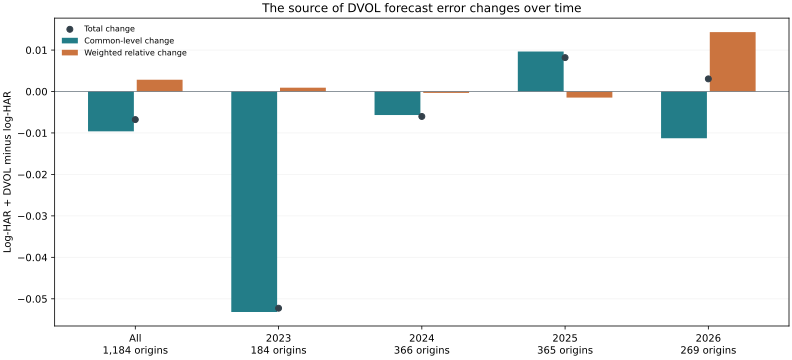

# Common and relative errors can pull QLIKE in opposite directions

Across 1,184 matched BTC/ETH origins, adding DVOL to separate marginal log-HAR models lowers average QLIKE from 0.10976651 to 0.10299355, a 6.17% point reduction. Across the 1,000 origins from January 2024 onward, mean loss rises from 0.10222012 to 0.10381836, a 1.56% deterioration. I chose this time breakdown after inspection.

For log actual-to-forecast errors $e_B$ and $e_E$, define $c=(e_E+e_B)/2$ and $r=e_E-e_B$. Then

$$\frac{Q_B+Q_E}{2}=\underbrace{e^c-c-1}_{\text{common-level penalty}}+\underbrace{e^c[\cosh(r/2)-1]}_{\text{weighted relative-error penalty}}.$$

This is exact accounting. A change in the relative term can reflect both its relative error and the common-level weight; it is not an identified market factor.

| Period | Origins | Common-level change | Weighted relative change | Total QLIKE change |
| --- | ---: | ---: | ---: | ---: |
| All | 1,184 | -0.00961011 | +0.00283715 | -0.00677296 |
| 2023 | 184 | -0.05318589 | +0.00091731 | -0.05226858 |
| 2024 | 366 | -0.00567778 | -0.00034339 | -0.00602117 |
| 2025 | 365 | +0.00964272 | -0.00147032 | +0.00817240 |
| 2026 | 269 | -0.01127767 | +0.01432250 | +0.00304483 |
| 2024 onward | 1,000 | -0.00159217 | +0.00319040 | +0.00159824 |

Negative changes favour log-HAR + DVOL. The 2025 common-level deterioration outweighs its relative improvement. In 2026 the common term improves, but the weighted relative term worsens by more.

Across the full sample, the relative penalty offsets 29.52% of the gross common-level improvement.

In 2026 the weighted relative contrast is positive at 86.62% of origins. Its ESS is 16.53. Its mean remains positive after removing the largest 1% or 5% of absolute contributions, or any single 60-day window. All 30 dependent nonoverlap phases have positive means. These checks are descriptive and reuse the same outcomes; the earlier inference-calibration failures still apply.

The numerical identity error is below 1e-12 at every origin. The computation reads the forecasts rebuilt from retained hourly data, rather than a saved plot.

[Rebuilt data](qlike-attribution.json) · [Matched study](eth-relative-results.md) · [Partial-settlement method](progressive-evidence.md)
